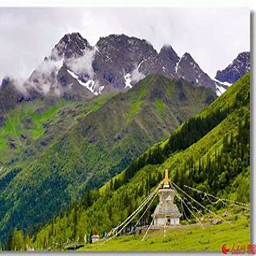
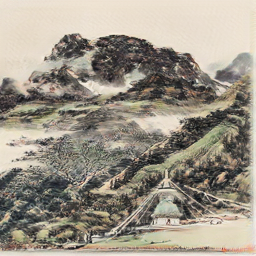
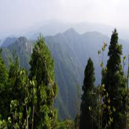
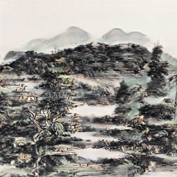
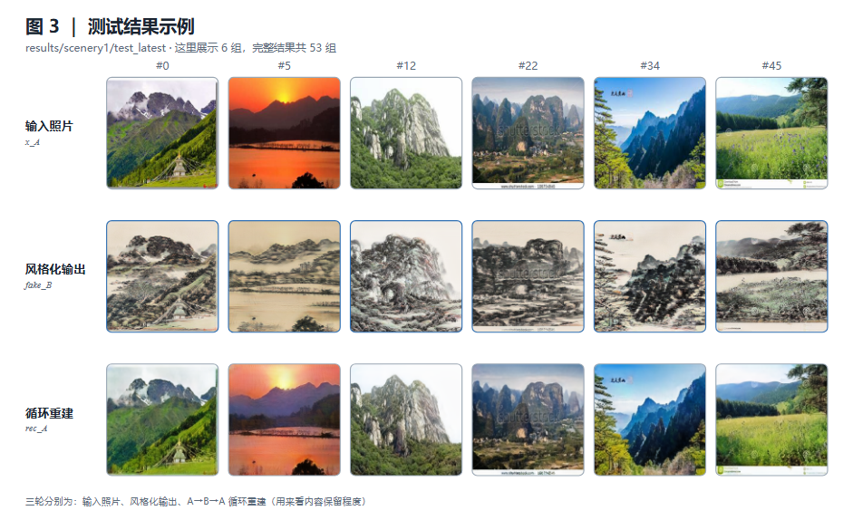

# 水墨山水风格化 · Ink-Wash Landscape Stylization

**无配对图像到图像的风格迁移：把风景照片转成水墨山水画。**


<sub>硕士学位工作 · 图学方向（计算机图形学与图像生成）</sub>

---

## 项目背景

这份代码完成于**硕班期间**。当时的精力几乎都投在方法上——把无配对风格迁移的问题定义清楚、把四组约束调到收敛、把实验结果做出来；工程侧则是"能跑通、能出图"就够，文档、依赖、路径配置这些都没顾上认真收拾。（写它的那两年，用大模型辅助写代码也还不是常态。）

方法本身是有内容的，代码不该一直停在那个状态。所以趁这段时间重新过了一遍：补齐说明与架构图，修掉会直接挡住别人复现的问题，把参数和路径从脚本里挪到明面上，并把当年知道却来不及处理的地方如实写出来（见 [已知问题](#已知问题与后续计划)）。

---

## 效果预览

左列为输入照片，右列为模型输出的水墨风格化结果（取自 `results/scenery1/`）：

<table>
<tr>
<td align="center"><br/><sub>输入照片</sub></td>
<td align="center"><br/><sub>风格化输出</sub></td>
<td align="center"><br/><sub>输入照片</sub></td>
<td align="center"><br/><sub>风格化输出</sub></td>
</tr>
</table>

## 更多结果



*图 3：`results/scenery1` 里的 6 组测试样本。第一行是输入照片、第二行是风格化输出、第三行走一遍 `A→B→A` 的循环重建——重建结果与输入基本重合，说明风格换了、内容没被改掉。仓库里这样的样本一共 50 组，每组 10 张（含反向生成、HED 边缘图、晕染图）。*

## 这是什么

水墨山水的风格迁移有个绕不开的困难：**没有配对数据**。同一处风景不可能同时存在一张照片和一张对应的水墨画，所以这里采用 CycleGAN 的无配对框架，让模型从"照片集"和"水墨画集"这两个互不相关的域里学出映射。

但把纯 CycleGAN 直接套到水墨上会出两个典型问题——**结构飘**（山体、树线、建筑的边缘在风格化后变形）和**墨味不足**（结果更像加了滤镜的照片，缺少水墨的晕染层次）。本工作在标准 CycleGAN 之上加了四组约束来针对性地解决它们：

| 约束 | 针对的问题 | 实现方式 | 权重 |
| --- | --- | --- | --- |
| **边缘一致性** | 结构飘 | HED 边缘检测器（冻结）分别提取输入照片与生成图的边缘概率图，用类别平衡交叉熵逼二者一致 | `λ_sup = 10`，第 150 轮起线性衰减到 0 |
| **水墨质感** | 墨味不足 | 对图像做形态学腐蚀 + 高斯模糊模拟晕染，再用额外判别器 `D_ink` 判别"像不像真水墨" | `λ_ink = 0.05` |
| **几何一致性** | 空间结构错乱 | InceptionV3 特征 → 几何网络 `netGeom` 回归几何图，与几何域标注做 BCE | `λ_Geom = 0.5` |
| **语义一致性** | 内容跑偏 | CLIP ViT-B/32 图像嵌入，约束输出与输入在语义空间接近 | `λ_recog = 0.5` |

## 方法总览


*图 1：主干结构。`x_A` 是照片域、`y_B` 是水墨域，两个生成器结构相同但权重独立；两个 PatchGAN 判别器分别判断"像不像真水墨"和"像不像真照片"。下面两条环路是循环一致性：`A→B→A` 与 `B→A→B` 共用同一个 `L_cyc`，另有恒等损失 `L_idt` 防止生成器自由改动色调整体分布。*


*图 2：四组额外约束。① 边缘一致用冻结的 HED 把结构钉住，权重随训练轮次线性退火；② 水墨质感先把图像做腐蚀 + 高斯模糊模拟晕染，再交给 `D_ink` 判别；③ 几何一致让 `netGeom` 从 Inception 特征回归几何图，与几何域标注比对；④ 语义一致用冻结的 CLIP 约束语义不跑偏。四条分支的损失与对抗、循环、恒等损失一起构成 `L_G`，一次反向传播更新两个生成器。*

> 想要能拖着玩的版本：[`docs/architecture.html`](docs/architecture.html) —— 每个节点都能用鼠标拖着重新排布，还能平移、缩放、导出 SVG。GitHub 不渲染 HTML 文件本身，下载到本地用浏览器打开即可（或用 Pages 托管）。

三个域之间的对应关系（`A → B` 是主任务，`B → A` 用于循环重建，`C` 只服务于几何一致性）：

```
照片 A ──G_A──▶ 水墨 B ──G_B──▶ 重建 A      # 循环一致
水墨 B ──G_B──▶ 照片 A ──G_A──▶ 重建 B      # 循环一致
照片 A ──D_B──▶ 真 / 伪                      # 对抗
水墨 B ──D_A──▶ 真 / 伪                      # 对抗
晕染图 ──D_ink──▶ 真 / 伪                    # 水墨质感
```

## 损失函数

生成器总损失（`models/cycle_gan_model.py` → `backward_G`）：

```
L_G = L_GAN(G_A, D_A) + L_GAN(G_B, D_B)                          # 对抗
    + λ_A · L1(G_B(G_A(A)), A) + λ_B · L1(G_A(G_B(B)), B)        # 循环一致
    + λ_idt · λ_B · L1(G_A(B), B) + λ_idt · λ_A · L1(G_B(A), A)   # 恒等
    + λ_sup · BCE_balanced(HED(G_A(A)), HED(A))                  # 边缘一致
    + λ_recog · MSE(CLIP(G_A(A)), CLIP(A))                        # 语义一致
    + λ_Geom · BCE(netGeom(InceptionV3(G_A(A))), depth_C)         # 几何一致
```

| 参数 | 训练脚本取值 | 含义 |
| --- | --- | --- |
| `--lambda_A` / `--lambda_B` | 10 / 10 | 双向循环一致权重 |
| `--identity` | 0.5 | 恒等映射损失缩放 |
| `--lambda_sup` | 10 | 边缘一致权重（第 150 轮起衰减） |
| `--start_dec_sup` | 150 | 开始衰减的轮次 |
| `--lambda_ink` | 0.05 | 水墨质感权重 |
| `--lambda_Geom` | 0.5 | 几何一致权重 |
| `--lambda_recog` | 0.5 | 语义一致权重 |
| `--niter` / `--niter_decay` | 100 / 100 | 前 100 轮固定学习率，后 100 轮线性衰减 |
| `--batchSize` | 1 | 单卡 batch |
| `--loadSize` / `--fineSize` | 286 / 256 | 短边先缩到 286，再随机裁到 256 |
| `--which_epoch` | 200 | 测试时加载第 200 轮权重 |

`λ_sup` 的衰减在 `train.py` 里按轮次线性计算：第 150 轮起从 10 降到 0——早期靠边缘约束把结构钉住，后期放开让水墨质感占主导。

## 网络结构

| 模块 | 类型 | 参数量级 | 是否训练 |
| --- | --- | --- | --- |
| `G_A` / `G_B` | ResNet 生成器，9 个残差块，`ngf=64`，InstanceNorm，无 dropout | ~11M | ✅ |
| `D_A` / `D_B` | PatchGAN，3 层，`ndf=64`，感受野 70×70 | ~2.7M | ✅ |
| `D_ink` | 同 PatchGAN，输入是晕染后的图 | ~2.7M | ✅ |
| `HED` | VGG16 特征 + 5 路侧输出融合的边缘检测头（`35.pth`） | ~14M | ❄️ 冻结 |
| `netGeom` | `GlobalGenerator2(768→3)`，从 Inception 特征回归几何图 | ~10M | ❄️ 冻结 |
| `InceptionV3` | 取 768 维特征（`net_recog`） | ~24M | ❄️ 冻结 |
| `CLIP ViT-B/32` | 图像嵌入，用于语义一致 | ~151M | ❄️ 冻结 |

## 实验与数据规模

| 项目 | 情况 |
| --- | --- |
| 训练集 | **未随仓库提供**。脚本期望 `scenery/trainA`、`trainB`（几何分支另需 `trainC`） |
| 测试照片 `testset/testA` | 80 张 |
| 测试水墨 `testset/testB` | 6 张 |
| `inkwash_dataset` 的 testA / testB | 5 / 6 张 |
| 已保存结果 | 552 个文件：`scenery1` 50 组 × 10 张 + `horse2` 实验 5 组 × 10 张 + 2 个索引页 |
| 生成器 | ResNet 9 blocks · `ngf=64` · InstanceNorm，约 11.4M 参数（按该结构推算） |
| 判别器 | PatchGAN 3 层 · `ndf=64` · 感受野 70×70，约 2.8M 参数 |
| 输入尺寸 | 训练：短边缩到 286 再随机裁 256；测试：`loadSize 256` |
| 训练轮次 / batch | 200 轮（前 100 固定学习率 + 后 100 线性衰减）/ batch 1 |

## 快速开始

### 1. 环境

```bash
conda create -n inkgan python=3.10.8 -y
conda activate inkgan
pip install -r requirements.txt
```

需要一张 CUDA 显卡（代码中保留了 `.cuda()` 调用，单卡即可，脚本里用 `CUDA_VISIBLE_DEVICES=0`）。

### 2. 数据组织

数据按域拆目录，**A 与 B 不需要配对**：

```
scenery/
├── trainA/     # 训练用照片
├── trainB/     # 训练用水墨画
├── trainC/     # 训练用几何图（与 A 一一对应）
├── testA/      # 测试用照片
├── testB/      # 测试用水墨画
└── testC/      # 测试用几何图
```

- `A` / `B` 必需；`C` 只被几何一致性用到。
- **只做推理**时不提供 `C` 也能跑（几何分支自动跳过）；训练时若没有 `C`，`λ_Geom` 这一项就失去意义。

### 3. 训练

```bash
bash train_horse2_edge_10_dec_150.sh
```

脚本内容（按需把 `--dataroot` 指向自己的数据、`--name` 改成实验名）：

```bash
CUDA_VISIBLE_DEVICES=0 python train.py \
  --dataroot ./scenery --name scenery --model cycle_gan --no_dropout \
  --lambda_sup 10 --lambda_A 10 --lambda_B 10 --start_dec_sup 150 \
  --lambda_ink 0.05 --lambda_Geom 0.5 --lambda_recog 0.5 \
  --loadSize 286 --fineSize 256 --batchSize 1 --which_epoch 200
```

### 4. 测试 / 推理

```bash
bash test_horse2_10_dec_150.sh
```

结果写到 `results/<name>/test_<epoch>/`，并同步生成 `index.html`，可以逐张对照查看。

### 5. 自检

```bash
python tools/check.py    # 等价于 make check
```

字节编译 `data/ models/ options/ util/` 与入口脚本（**不需要装 torch**），同时守卫「C 域可选」「CLIP 复用」「几何网络缺失可跳过」三处修复；若仓库里混入 `.pyc` / `__pycache__` 会直接失败。改完代码先跑这个，比等训练报错快得多。

## 预训练权重

| 权重 | 位置 | 说明 |
| --- | --- | --- |
| HED 边缘检测 | `35.pth`（仓库内，约 56 MB） | VGG16 骨干 + 5 路侧输出融合，训练时冻结 |
| 几何网络 | `checkpoints/feats2Geom/feats2depth.pth`（**仓库未包含**） | 通过 `--feats2Geom_path` 指定；缺失时请关掉几何分支 |
| 生成器 / 判别器 | `checkpoints/<name>/`（训练时自动保存） | 测试用 `--which_epoch` 指定轮次 |

## 目录结构

```
├── train.py / test.py                  # 入口
├── train_*.sh / test_*.sh              # 训练与测试脚本
├── options/                            # 命令行参数（base / train / test）
├── data/                               # 数据集与 DataLoader（unaligned，三域读取）
├── models/
│   ├── cycle_gan_model.py              # ★ 本项目的核心改动都在这里
│   ├── networks.py                     # 生成器 / 判别器 / netGeom / InceptionV3
│   └── model.py                        # HED 边缘检测网络
├── util/                               # 可视化、图像缓冲池等
├── docs/
│   ├── fig1-backbone.png               # 图 1：生成器与判别器主干
│   ├── fig2-constraints.png            # 图 2：四组辅助约束
│   └── architecture.html               # 可拖着玩的交互式架构图
├── 35.pth                              # HED 预训练权重
├── results/                            # 已有的测试输出
├── testset/ · inkwash_dataset/         # 测试图片
└── scripts/ · datasets/ · pretrained_models/   # 上游 CycleGAN 自带脚本，本项目未使用
```

## 结果目录说明

每张输入图会输出一组对比图：

| 文件名 | 含义 |
| --- | --- |
| `*_real_A.png` | 输入照片 |
| `*_fake_B.png` | **风格化输出（主要结果）** |
| `*_rec_A.png` | `A → B → A` 循环重建，用来看内容保留程度 |
| `*_real_B.png` | 同批测试中的水墨参考图 |
| `*_fake_A.png` | `B → A` 反方向生成 |
| `*_rec_B.png` | `B → A → B` 循环重建 |

## 已知问题与后续计划

代码里有几处能定位到、但尚未改动的地方，先如实记录，避免误用：

- **水墨质感损失目前只计算、未回传**：`backward_G` 算出了 `loss_G_ink` 并写进了日志，但没有加进 `loss_G` 的求和项——`D_ink` 在正常训练、日志里也有数字，可它对生成器**没有产生梯度**。要完整复现"水墨质感"约束，需要把 `+ loss_G_ink` 补进总损失并重训。
- **`netGeom` 的优化器建好了但没有 `step()`**，`save()` 里保存几何网络那行也被注释掉了——实际是当冻结网络在用。
- **`test()` 里部分输出是别名**：`edge_fake_B` / `ink_fake_B` 等在当前代码里直接指向 `fake_B` / `fake_A`。`results/` 里的图来自更早的版本，与当前 `test()` 的输出口径不完全一致。
- 代码使用 `.cuda()` 硬编码，无法在纯 CPU 环境运行。

计划：

- [ ] 把水墨质感损失接回总损失，做一次消融对比
- [ ] 补一个 C 域（几何 / 深度）的生成脚本，让数据准备可复现
- [ ] 用 `torch.cuda.amp` 混合精度把 batch 提到 2～4
- [ ] 去掉 `.cuda()` 硬编码，改为按 `--gpu_ids` 选择设备
- [ ] 补 `LICENSE` 与 `CITATION`

## 本次整理说明

这次整理的出发点很简单：让这份当年以"跑出结果"为目标的代码，变成别人拿到也能读、能跑、能复现的状态。以下修改都**不改变方法本身**：

| 改动 | 原因 |
| --- | --- |
| `data/unaligned_dataset.py`：C 域目录缺失时自动跳过 | 原来 `make_dataset` 对目录做 `assert`，而仓库里没有任何 C 域图片，`test.py` 一跑就报 `AssertionError`；现在只有 A / B 也能推理 |
| `models/cycle_gan_model.py`：语义一致损失改用已加载的 `self.clip_model` | 原实现在每次迭代里重复 `clip.load("ViT-B/32")`，权重被反复从磁盘读入，训练速度被严重拖慢；数学上完全等价 |
| `test_horse2_10_dec_150.sh`：数据路径改为相对路径 | 原来写死成 `/workspace/chip/ChipGAN/scenery`，换机器必然跑不起来 |
| 新增 `requirements.txt` / `.gitignore` | 依赖与忽略规则此前没有成文 |
| 移除已提交的 `__pycache__/` 与 `.pyc` | 编译产物不应进版本库 |
| 重写本 README，并加入可拖拽的架构图 | 原文只有 5 行 |
| 新增 `docs/fig1-backbone.png`、`docs/fig2-constraints.png`、`docs/architecture.html` | 用图讲清主干与四组约束，比纯文字快得多 |
| 把整理过程中的多条提交压成一条 | 改图、改措辞这类中间提交对别人没有意义 |

> 这些改动都不改变损失函数的数值（除了 C 域缺失时跳过几何分支）。**水墨质感损失未回传**属于方法层面的问题，需要确认后再改，而且改完必须重新训练才能反映到结果里。

> **维护提示**：替换 `docs/` 下的图之后，记得把 README 里对应图片 URL 的 `?v=N` 加一——GitHub 的图片 CDN 按 URL 缓存，路径不变就会一直发旧图。架构图从 Mermaid 改成静态 PNG 也是同一个原因：GitHub 端偶发 `Unable to render rich display`（本地用 mermaid 9.4–11.12 各版本验证都可渲染），静态图能保证任何人打开都看得到。

## 参考与致谢

- [junyanz/pytorch-CycleGAN-and-pix2pix](https://github.com/junyanz/pytorch-CycleGAN-and-pix2pix) —— 本仓库的代码骨架（BSD-2-Clause）
- [s9xie/hed](https://github.com/s9xie/hed) —— HED 边缘检测
- [openai/CLIP](https://github.com/openai/CLIP) —— 语义一致性约束
